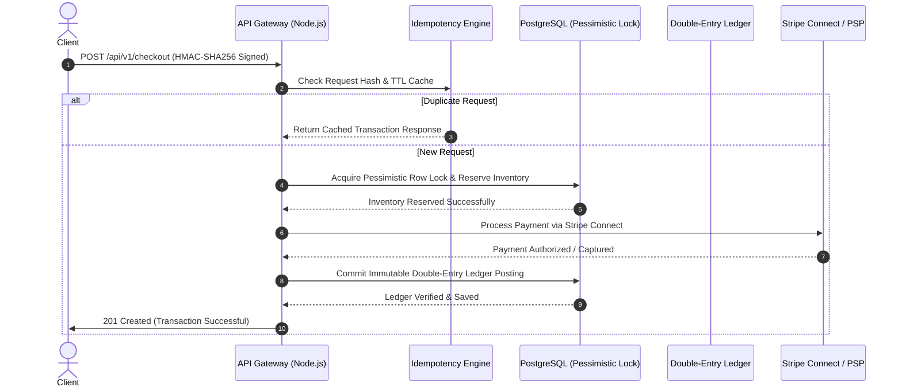

# Enterprise Checkout & Distributed Ledger System


An enterprise-grade e-commerce checkout and financial ledger architecture designed for high-concurrency transaction processing, deterministic inventory reservation, and idempotent multi-party payment orchestration via Stripe Connect.

---

## 📊 Enterprise Checkout & Distributed Ledger Flow



---

## 🏛️ Core FinTech Architectural Pillars

| Domain Module | Source Path | Architectural Guarantee & Financial Invariant |
| :--- | :--- | :--- |
| **Immutable Double-Entry Ledger** | `src/ledger/reconciliation-engine.ts` | Enforces strict `BigInt` zero-sum invariants ($\sum \text{Debits} - \sum \text{Credits} = 0$) across multi-party split settlements with zero floating-point drift. |
| **Merkle Tree Cryptographic Audit** | `src/ledger/merkle-audit.ts` | Computes domain-separated `SHA-256` Merkle roots across settlement batches for tamper-evident historical auditing. |
| **ISO-4217 FX & Bankers' Rounding** | `src/fx/currency-rounding.ts` | Deterministic `Half-to-Even` (Bankers') rounding across zero-decimal (`JPY`, `VND`), two-decimal (`USD`, `EUR`), and three-decimal (`KWD`) currencies. |
| **Idempotency & Mutation Guard** | `src/idempotency/distributed-lock.ts` | Canonical `SHA-256` request fingerprinting preventing double-charging and rejecting concurrent key reuse with mutated payloads. |
| **Transactional Outbox Pattern** | `src/outbox/transactional-outbox.ts` | Eliminates dual-write vulnerabilities by persisting domain events atomically within the same PostgreSQL ACID transaction. |
| **Constant-Time HMAC & Rate Limiter** | `src/security/` | Mitigates timing attacks via `crypto.timingSafeEqual`, enforces strict replay windows, and blocks flash-sale scalping bots via Token Bucket arithmetic. |
| **PSP Resilience Circuit Breaker** | `src/psp/circuit-breaker.ts` | State-driven `CLOSED` / `OPEN` / `HALF_OPEN` fault isolation protecting worker threads during upstream payment gateway degradation. |
| **Real-Time Fraud Velocity Engine** | `src/risk/velocity-engine.ts` | Sliding-window velocity evaluation mitigating card-testing attacks and triggering automated `3-D Secure (3DS)` step-up challenges. |
| **Chargeback & Escrow Saga** | `src/saga/chargeback-orchestrator.ts` | Deterministic state machine orchestrating dispute lifecycle transitions, merchant reserve escrow locking, and automated settlement clawbacks. |
| **PCI-DSS Level 1 Log Scrubber** | `src/compliance/pci-scrubber.ts` | Recursive payload sanitizer redacting PAN, CVV, IBAN, and cryptographic secrets prior to OpenTelemetry ingestion. |

---

## 📂 Repository Topology & Production Infrastructure

```text
enterprise-checkout-system/
├── .github/                  # CI/CD Pipelines, Dependabot, CODEOWNERS & PR Invariant Gates
├── chaos/                    # Chaos Mesh Network Latency & Pod Termination Fault Injection
├── docs/adr/                 # Architectural Decision Records (ADR-0001 to ADR-0003)
├── k8s/                      # Zero-Downtime Deployment, HPA Autoscaling & Zero-Trust NetworkPolicy
├── load-tests/               # k6 High-Concurrency Flash-Sale Benchmarking Suite
├── prisma/                   # PostgreSQL Schema (Serializable Isolation & Double-Entry Ledger)
├── src/
│   ├── compliance/           # PCI-DSS Level 1 Recursive Payload Sanitization
│   ├── fx/                   # ISO-4217 Multi-Currency Precision & Bankers' Rounding Engine
│   ├── idempotency/          # Distributed Locking & SHA-256 Request Fingerprinting
│   ├── ledger/               # Zero-Sum Reconciliation Engine & SHA-256 Merkle Audit Tree
│   ├── outbox/               # Transactional Outbox Factory for Guaranteed Event Delivery
│   ├── psp/                  # Upstream Stripe Connect Fault-Isolated Circuit Breaker
│   ├── risk/                 # Fraud Velocity Evaluation & 3DS Step-Up Trigger
│   ├── saga/                 # Multi-Party Chargeback & Escrow State Machine
│   ├── security/             # Constant-Time HMAC-SHA256 Verifier & Token Bucket Rate Limiter
│   ├── telemetry/            # OpenTelemetry Distributed Tracing SDK Pipeline
│   └── webhooks/             # Exponential Backoff with Full Jitter & Dead-Letter Queue Policy
├── tests/                    # Vitest Concurrency, Zero-Sum Ledger, FX & Cryptographic Suites
├── Dockerfile                # Multi-Stage Hardened Non-Root Alpine Production Container
├── Makefile                  # Unified Architect Command Orchestration
└── openapi.yaml              # Formal OpenAPI 3.1.0 Machine-Readable Gateway Contract
```

---

## 📑 Architectural Decision Records (ADRs) & Governance

* **[ADR-0001: Immutable Double-Entry Ledger Architecture](docs/adr/0001-immutable-double-entry-ledger.md)** — Enforcing append-only integer minor-unit postings over mutable balance columns.
* **[ADR-0002: Deterministic Pessimistic Inventory Locking](docs/adr/0002-pessimistic-inventory-locking.md)** — Utilizing ordered `SELECT ... FOR UPDATE NOWAIT` row locks to eliminate flash-sale overselling and deadlocks.
* **[ADR-0003: Transactional Outbox Pattern](docs/adr/0003-transactional-outbox-pattern.md)** — Guaranteeing atomic consistency between PostgreSQL ledger commits and asynchronous message brokers.
* **Operational Documentation:** See [ARCHITECTURE.md](ARCHITECTURE.md), [API.md](API.md), [RUNBOOK.md](RUNBOOK.md), [SECURITY.md](SECURITY.md), and [CHANGELOG.md](CHANGELOG.md).

---

## ⚡ Quick Start & Verification Suite

```bash
# 1. Install deterministic production & development dependencies
make install

# 2. Execute static type-checking and strict ESLint governance
make typecheck && make lint

# 3. Run unit, cryptographic, zero-sum ledger, and concurrency test suites with V8 coverage
make test

# 4. Execute k6 high-concurrency flash-sale load test
make load-test
```

---

## 💖 Sponsor This Project

If you find this enterprise-grade FinTech architecture valuable, consider supporting the development and maintenance of high-concurrency open-source financial systems.

[](https://github.com/sponsors/ValelethiaJohnson)
