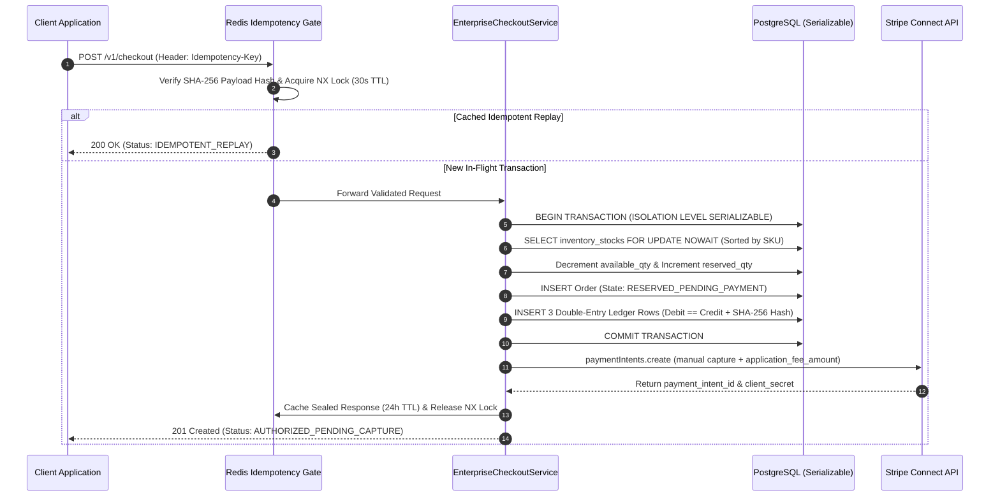

# Enterprise Checkout & Distributed Ledger System

[](https://github.com/ValelethiaJohnson/enterprise-checkout-system/actions)
[](https://opensource.org/licenses/Apache-2.0)
[](https://www.typescriptlang.org/)
[](https://www.prisma.io/)
[](https://stripe.com/connect)
[](https://www.postgresql.org/)

An enterprise-grade e-commerce checkout and financial ledger architecture designed for high-concurrency transaction processing, deterministic inventory reservation, and idempotent multi-party payment orchestration via **Stripe Connect**.

---

## 1. Core Architectural Pillars

* **Multi-Layer Idempotency Enforcement:** Combines a fast-path Redis distributed lock (`SET ... NX EX`) with cryptographic SHA-256 request payload fingerprinting. Protects upstream payment gateways from network retries, client double-clicks, and concurrent race conditions while detecting payload tampering across replayed `Idempotency-Key` headers.
* **Deadlock-Free Pessimistic Inventory Control:** Eliminates flash-sale overselling by sorting SKU lock acquisition deterministically in lexicographical order and executing row-level locking (`SELECT ... FOR UPDATE NOWAIT`) inside PostgreSQL `Serializable` transactions.
* **Immutable Double-Entry Accounting Engine:** Replaces mutable balance columns with an append-only financial ledger (`ledger_entries`). Every checkout operation enforces a strict zero-sum invariant ($\sum \text{Debits} = \sum \text{Credits}$) across `CUSTOMER_CLEARING_RECEIVABLE`, `MERCHANT_ESCROW_PAYABLE`, and `PLATFORM_REVENUE_FEE` accounts, sealed with a SHA-256 audit trail hash.
* **Two-Phase Stripe Connect Split Payments:** Orchestrates manual authorization holds (`capture_method: 'manual'`) with automated platform fee deduction (`250 bps` / `2.5%`) and destination escrow routing, decoupling database lock duration from external PSP network latency.
* **Zero Floating-Point Drift (ISO 4217):** All monetary fields, fee calculations, and database columns operate exclusively in minor currency units (`BigInt` cents) to eradicate IEEE 754 floating-point rounding anomalies.

---

## 2. Distributed Transaction & Concurrency Flow



---

## 3. Double-Entry Ledger Accounting Model

Every order processed by `EnterpriseCheckoutService` generates an immutable, balanced set of accounting entries prior to upstream PSP invocation. For a **$100.00 USD** (`10000` cents) checkout with a **2.5%** (`250` cents) platform fee:

| Account Type | Direction | Amount (Minor Units) | Purpose |
| :--- | :---: | :---: | :--- |
| `CUSTOMER_CLEARING_RECEIVABLE` | `DEBIT` | `10000` | Captures gross customer payment obligation |
| `MERCHANT_ESCROW_PAYABLE` | `CREDIT` | `9750` | Net settlement liability owed to the connected merchant |
| `PLATFORM_REVENUE_FEE` | `CREDIT` | `250` | Marketplace orchestration fee retained by the platform |

> **Accounting Invariant:** $\sum \text{Debits} (10000) - \sum \text{Credits} (9750 + 250) = 0$. Rows in `ledger_entries` intentionally omit `updatedAt` timestamps and enforce `onDelete: Restrict` constraints at the database level.

---

## 4. Repository Structure

```text
enterprise-checkout-system/
├── .github/
│   └── workflows/
│       └── ci.yml                 # Automated build & manifest verification pipeline
├── prisma/
│   └── schema.prisma              # PostgreSQL schema (Order, LedgerEntry, InventoryStock, WebhookEventLog)
├── src/
│   ├── services/
│   │   └── checkout.service.ts    # Core idempotent checkout & ledger orchestration engine
│   └── types/                     # Domain interfaces and strict type definitions
├── .env.example                   # Enterprise environment configuration template
├── .gitignore                     # Artifact and credential exclusion rules
├── LICENSE                        # Apache-2.0 Open Source License
├── package.json                   # Runtime dependencies & verification scripts
└── tsconfig.json                  # Strict TypeScript compiler configuration
```

---

## 5. Engineering Decisions & Trade-offs (ADR Summary)

1. **Why `FOR UPDATE NOWAIT` instead of Optimistic Concurrency Control (OCC)?**
   During high-contention flash sales on hot SKUs, OCC (`version` column checks) triggers excessive retry storms and transaction aborts. Pessimistic locking with `NOWAIT` fails fast when contention exceeds threshold limits while deterministic SKU sorting (`a.skuId.localeCompare(b.skuId)`) mathematically prevents circular wait deadlocks.
2. **Why decouple Stripe API calls from the Database Transaction?**
   Executing external HTTP calls to Stripe inside an open PostgreSQL `Serializable` transaction holds row locks across unpredictable network I/O (200ms–2000ms), exhausting connection pools. We commit the `RESERVED_PENDING_PAYMENT` state and ledger entries locally first, then invoke Stripe Connect using a deterministic key (`stripe:pi:${idempotencyKey}`).
3. **Why Strict TypeScript Compiler Flags?**
   `noUncheckedIndexedAccess`, `strictNullChecks`, and `exactOptionalPropertyTypes` are enforced in `tsconfig.json` to guarantee compile-time safety when handling financial payloads and array bounds.

---

## 6. Local Development & Verification

### Prerequisites
* **Node.js** `>= 20.0.0 LTS`
* **PostgreSQL** `>= 15`
* **Redis** `>= 7.0`

### Setup & Execution

```bash
# 1. Install dependencies
npm install

# 2. Configure environment variables
cp .env.example .env

# 3. Generate Prisma Client & deploy database schema
npm run db:generate
npm run db:migrate

# 4. Run strict TypeScript type verification & test suite
npm run typecheck
npm test
```

---

## 7. Security & Compliance

* **PCI-DSS Scope Reduction:** Raw Primary Account Numbers (PAN) and CVV data never touch this service; card tokenization is delegated directly to Stripe Elements / PaymentIntents (`client_secret`).
* **Cryptographic Audit Trails:** Every ledger batch is stamped with a deterministic SHA-256 digest (`orderId:amountMinor:idempotencyKey`) indexed via `idx_ledger_entries_audit_hash` for continuous reconciliation.

---

## License

Licensed under the **Apache License, Version 2.0**. See [LICENSE](./LICENSE) for full details.

**Architected & Maintained by [Valelethia Johnson](https://github.com/ValelethiaJohnson)** — *Principal FinTech & Payment Systems Architect*.
